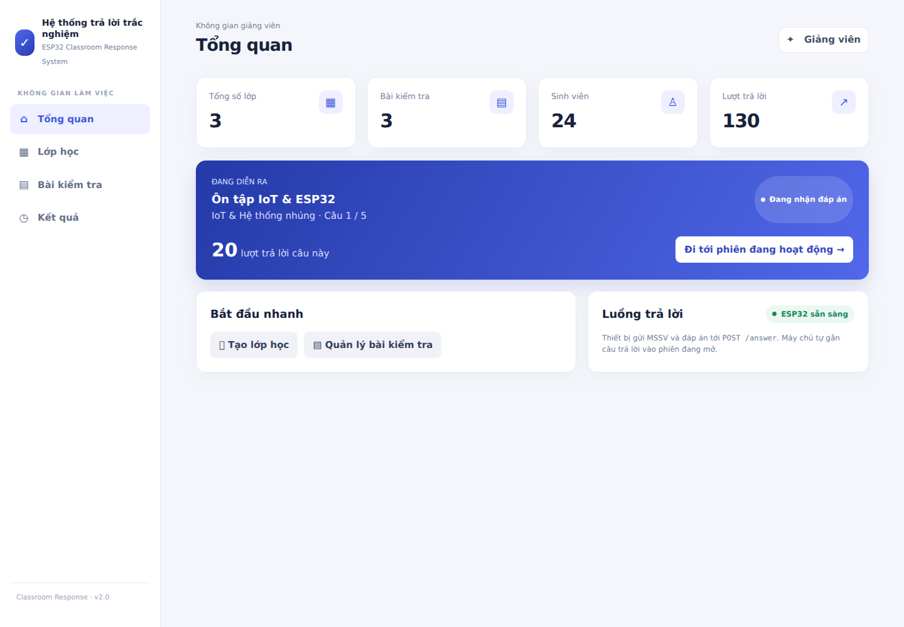
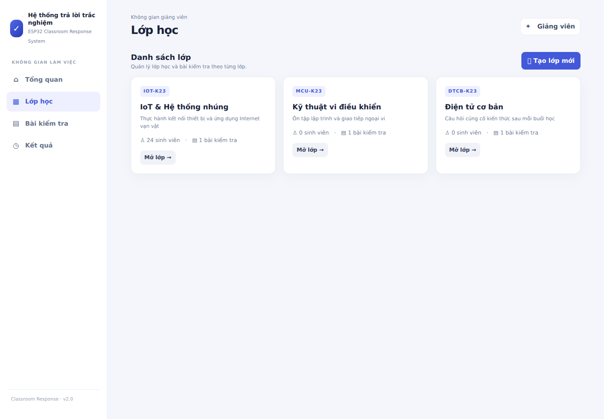
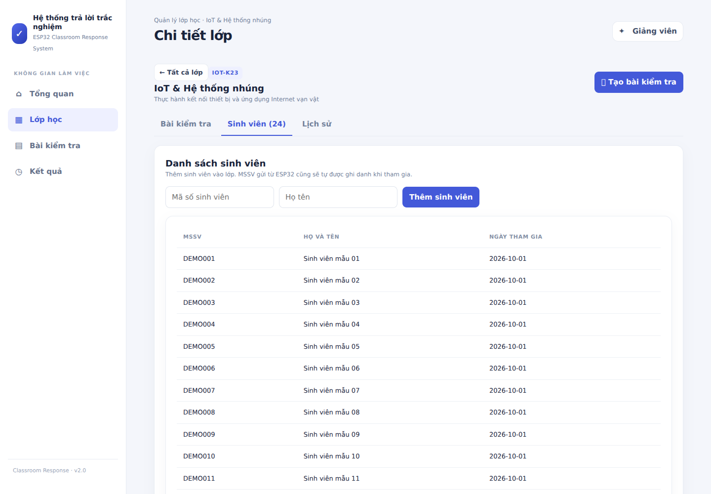
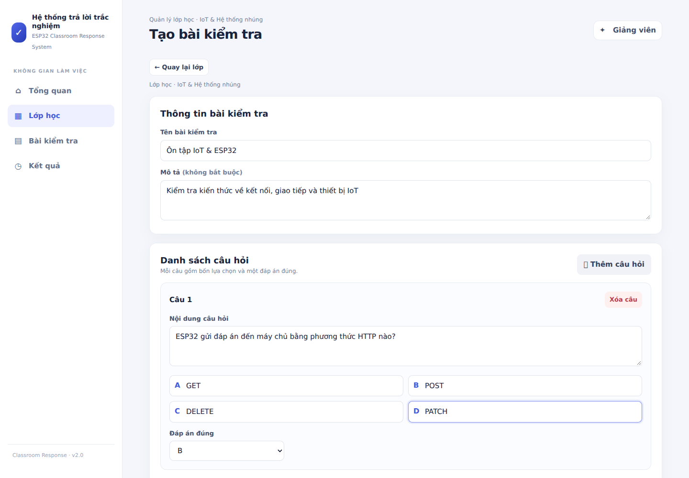
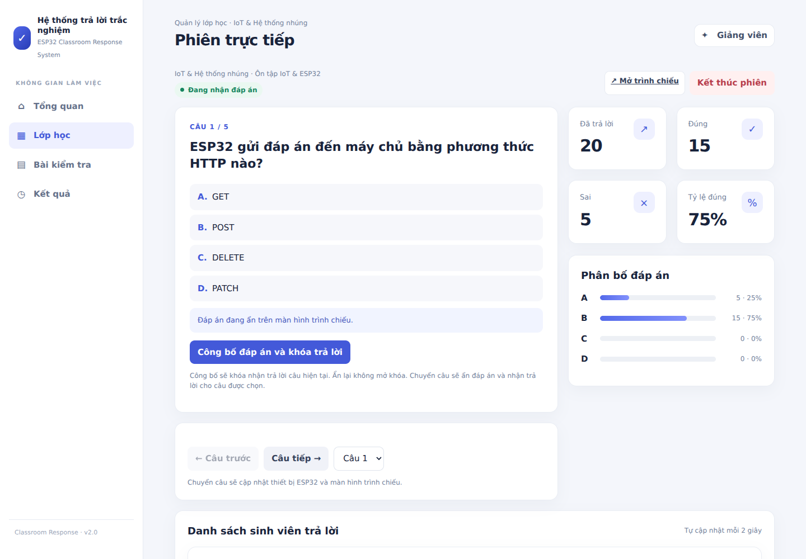
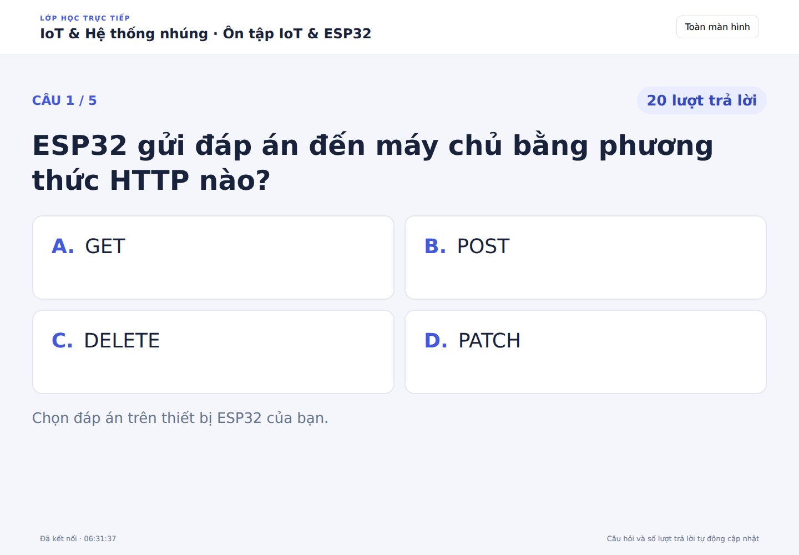
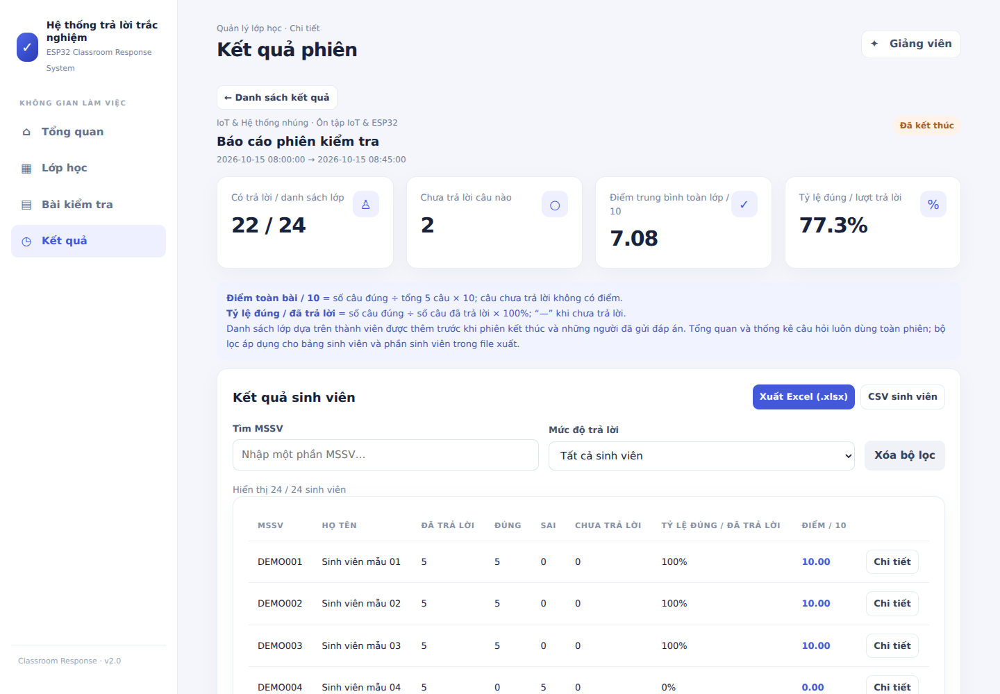
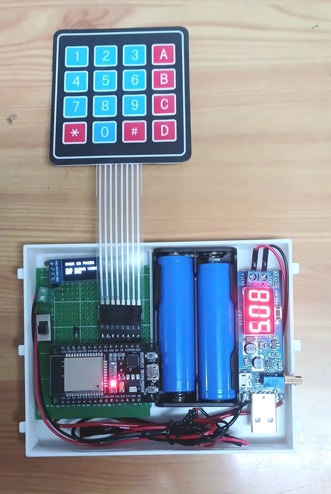
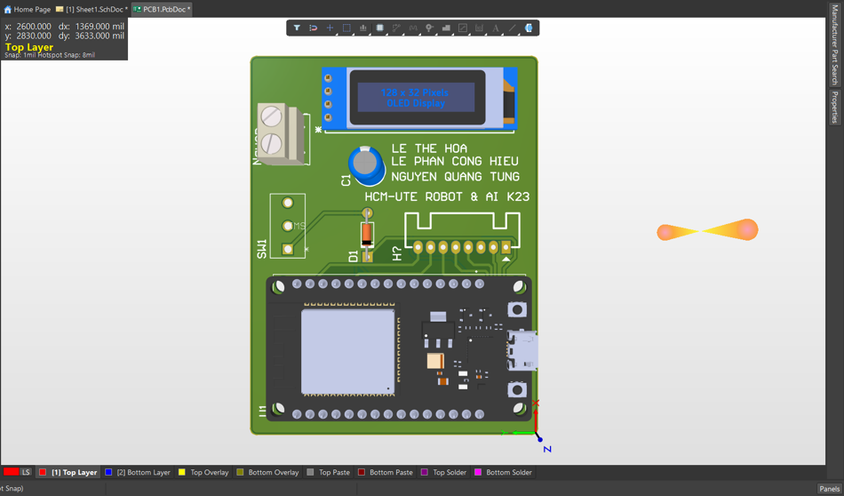

# THIẾT KẾ VÀ CHẾ TẠO THIẾT BỊ IOT TRẢ LỜI CÂU HỎI TRẮC NGHIỆM DÀNH CHO HỌC SINH, SINH VIÊN

**Thiết bị ESP32 kết hợp website quản lý lớp học, tổ chức trắc nghiệm và thống kê kết quả.**

Dự án xây dựng một hệ thống tương tác trong lớp học: học sinh, sinh viên dùng thiết bị cầm tay để nhập mã số và chọn đáp án A–D; giáo viên sử dụng website để soạn câu hỏi, điều khiển buổi kiểm tra và theo dõi kết quả. Các câu trả lời được gửi qua Wi-Fi đến máy chủ và gắn với đúng phiên kiểm tra, câu hỏi đang mở.

## Website quản lý trắc nghiệm

Website là trung tâm điều hành của hệ thống. Giao diện tiếng Việt tổ chức theo bốn nhóm chính: **Tổng quan, Lớp học, Bài kiểm tra và Kết quả**. Giáo viên có thể chuẩn bị nội dung trước buổi học, mở phiên trực tiếp rồi xem báo cáo sau khi kết thúc.

> Các ảnh website bên dưới được chụp từ ứng dụng đang chạy với dữ liệu minh họa. Mã `DEMO…` và tên “Sinh viên mẫu” dùng để giới thiệu chức năng.

### 1. Tổng quan hệ thống

Thống kê số lớp, bài kiểm tra, sinh viên và lượt trả lời. Phiên đang diễn ra được làm nổi bật, cho phép giáo viên truy cập nhanh màn hình điều khiển.



### 2. Quản lý lớp học

Mỗi lớp có mã lớp, tên, mô tả, số sinh viên và số bài kiểm tra. Giáo viên tạo lớp, mở danh sách và quản lý nội dung theo từng lớp học.



### 3. Danh sách sinh viên

Thêm mã số và họ tên sinh viên, xem thành viên của từng lớp. Website cũng hỗ trợ ghi danh sinh viên khi thiết bị tham gia gửi đáp án theo logic của máy chủ.



### 4. Soạn bài kiểm tra

Tạo bài kiểm tra có tên, mô tả và nhiều câu hỏi. Mỗi câu gồm nội dung, bốn lựa chọn A–D và một đáp án đúng; có thể thêm, xóa câu và lưu lại để sử dụng trong buổi học.



### 5. Điều khiển phiên trực tiếp

Hiển thị câu hiện tại, chuyển câu trước/sau và theo dõi đáp án gửi từ ESP32. Biểu đồ thể hiện phân bố lựa chọn A–D; các chỉ số cho biết số lượt trả lời, số đúng, số sai và tỷ lệ đúng. Giáo viên có thể công bố đáp án, khóa nhận trả lời và kết thúc phiên.



### 6. Trình chiếu cho lớp học

Màn hình trình chiếu riêng hiển thị câu hỏi và bốn lựa chọn với chữ lớn. Đáp án đúng được ẩn trước khi công bố; giáo viên giữ màn hình quản lý trên máy cá nhân trong khi trình chiếu cho cả lớp.



### 7. Kết quả và báo cáo

Tổng hợp điểm theo thang 10, mức độ tham gia, số câu đúng/sai và câu chưa trả lời. Có bộ lọc mã sinh viên, mức độ trả lời, thống kê từng câu và chức năng xuất Excel/CSV để lưu trữ kết quả.



## Phần cứng thiết bị

### Thiết bị thực tế

Thiết bị sử dụng **ESP32**, **bàn phím ma trận 4×4** và **OLED**. Bàn phím phục vụ nhập mã số, chọn đáp án và xác nhận; OLED hiển thị trạng thái làm bài. Ảnh thực tế còn cho thấy bộ pin, mạch nguồn và cách bố trí các thành phần trong vỏ thiết bị.

<p align="center"></p>

### Thiết kế PCB

Mô hình PCB thể hiện bố trí ESP32, màn hình OLED, đầu nối và các linh kiện trên bo mạch, phục vụ thiết kế và lắp ráp thiết bị.



## Quy trình hoạt động

1. Giáo viên tạo lớp, nhập danh sách sinh viên và chuẩn bị bộ câu hỏi trên website.
2. Bắt đầu phiên kiểm tra và mở màn hình trình chiếu nếu cần.
3. Sinh viên nhập mã số trên thiết bị, nhấn `#` để xác nhận.
4. Thiết bị đồng bộ câu hỏi đang mở; sinh viên chọn A–D và xác nhận theo hướng dẫn OLED.
5. ESP32 gửi đáp án qua Wi-Fi; website cập nhật thống kê và danh sách trả lời.
6. Giáo viên chuyển câu, công bố đáp án, kết thúc phiên và xuất báo cáo.

## Công nghệ

| Thành phần | Công nghệ |
| --- | --- |
| Vi điều khiển | ESP32, ESP-IDF, C |
| Nhập liệu | Bàn phím ma trận 4×4 |
| Hiển thị | OLED I²C 128×32 |
| Máy chủ | Python, Flask |
| Cơ sở dữ liệu | MySQL/MariaDB |
| Giao diện | HTML, CSS, JavaScript |

## Cấu trúc mã nguồn

- `main/`: firmware ESP32, Wi-Fi, HTTP, bàn phím và OLED.
- `server/`: máy chủ Flask, giao diện, báo cáo và kiểm thử.
- `server/database/`: các tập lệnh nâng cấp cơ sở dữ liệu.
- `tools/`: công cụ hỗ trợ build, nạp firmware, cấu hình IP và chạy máy chủ.
- `sdkconfig`, `CMakeLists.txt`, `dependencies.lock`: cấu hình dự án ESP-IDF.
- `IOT.zip`: bản mã nguồn gọn để tải xuống.

## Kết nối phần cứng theo mã nguồn

| Thiết bị | Chân ESP32 |
| --- | --- |
| Hàng bàn phím R1, R2, R3, R4 | GPIO14, GPIO27, GPIO26, GPIO25 |
| Cột bàn phím C1, C2, C3, C4 | GPIO33, GPIO32, GPIO21, GPIO22 |
| OLED SDA | GPIO18 |
| OLED SCL | GPIO19 |

OLED dùng địa chỉ I²C `0x3C`. Kiểm tra nguồn cấp, GND và sơ đồ thiết bị thực tế trước khi đấu nối.

## Chạy máy chủ

```bash
python3 -m venv server/.venv
source server/.venv/bin/activate
pip install -r server/requirements.txt
export DB_HOST=localhost
export DB_USER=esp32app
export DB_PASSWORD='MAT_KHAU_CUA_BAN'
export DB_NAME=esp32_db
python server/server.py
```

Mở `http://localhost:5000`. Máy chủ cần cơ sở dữ liệu phù hợp trước khi sử dụng. Xem [hướng dẫn máy chủ](server/README.md) về các phiên bản và migration. `migration_v2.sql` chỉ chạy một lần trên cấu trúc cũ; `migration_v3.sql` bổ sung chức năng trình chiếu. Sao lưu cơ sở dữ liệu trước khi nâng cấp.


## Cấu hình và nạp ESP32

1. Cài đặt và kích hoạt môi trường ESP-IDF tương thích với dự án.
2. Sửa `YOUR_WIFI_SSID`, `YOUR_WIFI_PASSWORD` trong `main/main.c`.
3. Cập nhật địa chỉ IP máy chủ trong `main/http_client.c` để ESP32 truy cập được qua mạng nội bộ.
4. Tại thư mục gốc dự án, chạy:

```bash
idf.py set-target esp32
idf.py build
idf.py -p PORT flash monitor
```

Thay `PORT` bằng cổng nối tiếp thực tế. ESP32 và máy chủ phải truy cập được nhau; mở cổng 5000 trên máy chủ nếu cần.

## Cách sử dụng

1. Chạy máy chủ và mở trang quản lý.
2. Tạo lớp, thêm sinh viên, tạo bộ câu hỏi và bắt đầu phiên kiểm tra.
3. Nhập mã số trên thiết bị, nhấn `#` để xác nhận.
4. Chọn đáp án A–D và thao tác xác nhận theo thông báo OLED.
5. Giáo viên chuyển câu, công bố đáp án, kết thúc phiên và xuất kết quả.

